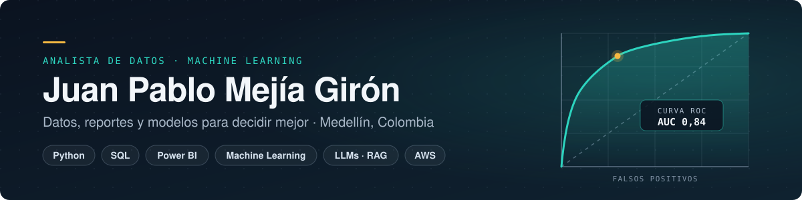

  

## Sobre mí

Soy ingeniero con énfasis en analítica de datos e inteligencia artificial, con dos años de experiencia en analítica de datos, elaboración de reportes y automatización de procesos. Trabajo con Python, SQL, Excel y Power BI para depurar datos, analizarlos y convertirlos en reportes que apoyan la toma de decisiones, y aplico Machine Learning e IA generativa (LLMs, RAG) en proyectos de principio a fin: desde el análisis exploratorio hasta el despliegue.

## Proyectos destacados

| Proyecto | Qué hace | Tecnologías |
| --- | --- | --- |
| [**Asistente de documentos con RAG**](https://github.com/Git-JuanM/Proyectos_Personales_Juan/tree/main/rag-onedrive-google-drive) | Responde preguntas sobre documentos de OneDrive y Google Drive y cita el archivo de origen. Ingesta incremental de PDF, Word, CSV y Google Docs, autenticación OAuth 2.0 de solo lectura y 24 pruebas automatizadas. | Python · LangChain · IBM watsonx.ai · Chroma · Gradio · Microsoft Graph API · Google Drive API |
| [**API de predicción de churn en AWS**](https://github.com/Git-JuanM/Proyectos_Personales_Juan/tree/main/api-prediccion-churn-aws) | Red neuronal que predice la cancelación de clientes de telecomunicaciones (AUC 0,82 · accuracy 0,79), servida con una API REST que valida la entrada y registra cada consulta en MySQL. Desplegada en EC2 con base de datos en RDS. | Python · TensorFlow/Keras · scikit-learn · FastAPI · MySQL · AWS EC2 · AWS RDS |
| [**Predicción de churn y explicabilidad**](https://github.com/Git-JuanM/Proyectos_Personales_Juan/tree/main/prediccion-churn-telco) | Análisis de 7.043 clientes para identificar los factores más ligados a la cancelación (contrato y antigüedad). Comparación de modelos con validación cruzada; Random Forest elegido (AUC 0,84 · recall 0,76) y explicado con SHAP. | Python · pandas · scikit-learn · PyCaret · SHAP · matplotlib · seaborn |

## Stack

| Área | Herramientas |
| --- | --- |
| **Análisis de datos y BI** | SQL avanzado (MySQL) · Excel avanzado · Power BI (DAX, Power Query) · dashboards y KPIs · EDA |
| **Programación y datos** | Python (pandas, scikit-learn, TensorFlow/Keras) · pipelines ETL · APIs · Git |
| **Machine Learning** | Clasificación · regresión logística · árboles de decisión · Random Forest · redes neuronales · validación cruzada · SHAP |
| **IA generativa** | LLMs · RAG · agentes · prompt engineering · fine-tuning · LangChain · IBM watsonx.ai · Chroma |
| **Automatización y nube** | Power Automate · Microsoft 365 · AWS (EC2, RDS) |

## Experiencia

**Auxiliar Analítico · Universidad EAFIT, en colaboración con el Metro de Medellín** — 2025  
Automaticé la elaboración de reportes con Power Automate, Excel y MySQL, lo que redujo en un 50 % su tiempo de creación. Hice análisis exploratorio en Python, participé en el desarrollo de modelos de Machine Learning y mantuve los reportes del proyecto en Power BI.

**Analítico · Gobernación de Antioquia** — 2024  
Analítica de datos con Python y Excel como soporte a las áreas de la entidad, y automatización de procesos con Microsoft Power Platform.

## Formación

**Ingeniería Mecatrónica, énfasis en analítica de datos e inteligencia artificial** · ITM (2024)  
Cursos: Ingeniero de IA (IBM) · Ciencia de datos con Python (IBM) · Analítica de datos con Power BI  
Idiomas: español (nativo) · inglés B2

## Contacto

Medellín, Colombia · [juanmejia.mk1@gmail.com](mailto:juanmejia.mk1@gmail.com)
